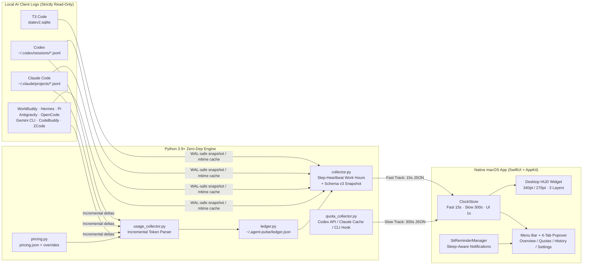

# Architecture & Methodology

This document explains how **AgentPulse** measures pure AI work hours, reconciles multi-source tokens and costs, prevents double counting, and maintains sub-200ms refresh latency on macOS.

---

## 1. System Overview (Dual-Track + 1s UI Tick)

AgentPulse separates **local read-only telemetry** from **slow subscription quota checks** so network latency or offline environments never block desktop responsiveness.



| Track | Cadence | Target Latency | Scope | Failure Strategy |
|---|---:|---:|---|---|
| **UI Tick** | `1s` (in-memory) | `< 1 ms` | Live agent timers `+1s`, sit reminder countdown `-1s` | Zero I/O |
| **Fast Track** | `15s` (100% local) | `< 200 ms` | Work hours, live active detection, incremental tokens/cost, ledger update | Keep previous snapshot; never blank UI |
| **Slow Track** | `300s` (or manual) | `< 3 s` | Subscription quotas (Codex API/JSONL, Claude statusline/Desktop cache, snapshots) | Silent fallback to cached reading + stale status |

---

## 2. Step-Heartbeat Pure AI Execution Algorithm

Measuring "AI work hours" naively from session start to session end badly overcounts whenever a human pauses to read output, switch tabs, or approve a command. Conversely, imposing a hard 30-minute cap per turn undercounts genuine autonomous multi-step runs.

AgentPulse solves this in `engine/collector.py` (`build_heartbeat_segments`) with four rules:

1. **5-Minute Inter-Step Heartbeat (`HEARTBEAT_GAP_SECONDS = 300s`)**:
   - Every turn starts at `turn_start` and collects all intra-turn agent activity timestamps (`step_timestamps`: reasoning blocks, tool calls, tool results, item completions, assistant messages).
   - Adjacent timestamps `(a, b)` with `0 < b - a <= 300s` form an active work interval `[a, b]`.
   - Any silent gap `> 300s` is **dropped completely (`0s` added)** — no partial credit for idle waiting.
   - There is **no artificial 30-minute total turn cap**: a continuous autonomous run with events every 2–4 minutes for 90 minutes counts the full 90 minutes.
2. **Bounded Opaque Execution Spans (`SINGLE_STEP_CAP_SECONDS = 900s`)**:
   - Explicit `[startedAt, completedAt]` spans for real execution items (e.g., long shell commands or reasoning steps) are unioned into the timeline, individually capped at 15 minutes as a sanity guardrail.
3. **Explicit Human-Wait Subtraction (T3 Code)**:
   - T3 Code logs explicit wait events (`approval_request`, `user_input_request`, `secret_request`, and `orchestration_v2_projection_runtime_requests`).
   - Those exact `[created_at, resolved_at]` intervals are **subtracted** (`subtract_exclusions`) even when shorter than 5 minutes.
   - If a running T3 run currently has a pending human wait request, it is **not** marked as live-active ("在岗").
4. **Midnight Day Splitting**:
   - Every `WorkSegment` crossing `00:00` in the business timezone (`Asia/Shanghai`, UTC+8) is cleanly split across days (`split_segment_by_biz_day`) while preserving `is_turn_head` so turn counts (`runs`) are never double-counted.

### Workdays & Parallel Leverage

- **Cumulative AI Hours (`agent_hours`)**: Sum of all pure-AI segment durations across all tools and parallel sessions.
- **AI Workdays (`workdays`)**: `agent_hours / 8.0` (1 standard 8-hour workday).
- **Deduplicated Wall Clock (`wall_hours`)**: Duration of the mathematical union (`merge_wall_seconds`) of all work intervals — overlapping parallel tasks are counted once.
- **Parallel Leverage (`leverage`)**: `agent_seconds / wall_seconds` (minimum `1.00×` when idle).
  - *Example*: Two agents each run independently for 30 minutes at the exact same time → `agent_hours = 1.00h`, `wall_hours = 0.50h`, `leverage = 2.00×`.

---

## 3. Deduplication & Ledger Reconciliation

### T3 Code ↔ Codex Bidirectional Deduplication

When T3 Code runs Codex as a provider, Codex still writes session JSONL files under `~/.codex/sessions/`. Both `collector.py` and `usage_collector.py` inspect each Codex file's `session_meta.payload.originator`:

- **Work Hours**: `parse_codex_file()` skips files where `originator == "T3 Code"` (since T3 Code's `statev2.sqlite` already tracks those runs with finer human-wait exclusions).
- **Tokens & Cost**: `_parse_codex_file()` attributes `originator == "T3 Code"` files to `t3_codex` and standalone sessions to `codex`.

### Codex New/Legacy Event Deduplication

Newer Codex builds can emit both `token_usage_record` (per-response usage + `response_id`) and legacy `event_msg` (`token_count` cumulative snapshots) inside the same JSONL file. `usage_collector.py`:
- Tracks `response_id` within a file to ignore duplicate records.
- Tracks cumulative `prev_total` tuples `(input, cached, cache_write, output, reasoning)` to compute exact deltas and skip echoed snapshots regardless of whether old or new events appear first.

### Ledger Reconciliation (`~/.agent-pulse/ledger.json`)

`engine/ledger.py` keeps two separate namespaces:
- `imported_tools`: Historical daily totals migrated from Tokei (`scripts/import_tokei.py`).
- `live_tools`: Daily totals incrementally computed by AgentPulse.

Reconciliation order (`_reconcile_merged_tools`):
1. Start from `imported_tools` (skipping imported `codex` on any day that already has live `codex` or `t3_codex` records).
2. Overlay persisted `live_tools` (preserves live days older than the 14-day active scan window).
3. Overlay fresh `live_usage` (authoritative for the active scan window).

---

## 4. Caching & SQLite Safety

- **JSONL Incremental Caches**:
  - Work hours: `~/.agent-pulse/cache.json` (`CACHE_VERSION = 3`), keyed by `file_path -> (mtime_ns, size)`. Files modified within the last `105s` bypass cache to ensure real-time accuracy.
  - Token usage: `~/.agent-pulse/usage_cache.json` (`USAGE_CACHE_VERSION = 2`), keyed by `file_path -> (mtime_ns, size)`.
- **SQLite WAL-Safe Snapshots**:
  - `open_sqlite_readonly_snapshot()` copies `<db>`, `<db>-wal`, and `<db>-shm` into a private `tempfile.mkdtemp()` folder, opens it read-only, runs queries, closes the handle, and removes the temp directory in a `finally` block.

---

## 5. Snapshot JSON Schema (v3)

Running `python3 engine/collector.py --days 14 --pretty` outputs:

```json
{
  "schema_version": 3,
  "generated_at": "2026-11-26T21:00:00+08:00",
  "generated_ts": 1795698000.0,
  "timezone": "Asia/Shanghai",
  "guardrails": {
    "mode": "step_heartbeat",
    "heartbeat_gap_minutes": 5,
    "workday_hours": 8,
    "max_turn_minutes": 0,
    "max_step_gap_minutes": 5
  },
  "today": {
    "date": "2026-11-26",
    "agent_hours": 4.22,
    "workdays": 0.53,
    "wall_hours": 2.51,
    "leverage": 1.68,
    "runs": 42,
    "tokens": 8060000,
    "cost_usd": 0.84,
    "cache_hit_rate": 0.86,
    "tools": []
  },
  "last_7_days": [],
  "summary_7d": { "total_hours": 18.4, "avg_daily_hours": 2.63, "active_days": 7 },
  "days": [],
  "active_agents": [],
  "tokei_ref": { "available": true, "today_tokens": 8060000, "today_cost_usd": 0.84 },
  "usage": {
    "source": "agent_pulse_native",
    "periods": { "today": {}, "week": {}, "month": {}, "year": {} },
    "history_30d": [],
    "ledger_meta": {}
  },
  "elapsed_ms": 142.3
}
```
